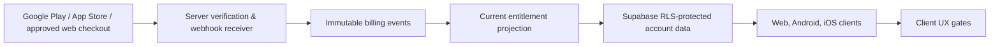

# DoneDay global readiness and monetization audit

**Audit date:** 26 October 2026  
**Repository reviewed:** `Demas/doneday-todo-app` at `1cc7b25`  
**Scope:** architecture and readiness review only. No application source, database schema, credentials, deployment, user data, alarms, or APK contents were changed.

## Executive summary

DoneDay has a credible foundation for an Android-first task and reminder product: a React/Vite PWA, optional Supabase account sync, server-side web-push schedules, and a Capacitor Android host with a real native alarm path. The application is **not ready for a global store launch or paid subscriptions** yet. The main work is reliability and operational readiness, rather than a rewrite.

The strongest current capability is the Android Smart Alarm flow. The repository schedules `AlarmManager.RTC_WAKEUP` alarms, retains definitions across process death and reboot, presents a high-priority notification and full-screen activity, and supplies Stop and Snooze actions. The project owner previously reported a successful Android 11 device test covering ringing, vibration, Stop, Snooze, and a scheduled task alarm. That is the only physical-device evidence reviewed here; it is not a substitute for this audit's proposed device matrix.

The principal launch blockers are:

1. **P0 — Alarm semantics are not globally specified.** Alarm time zones are arbitrary text, can silently resolve to GMT on Android, and are stored per item while cloud schedules use the profile time zone. A traveller can receive a task at an unexpected local time.
2. **P0 — Android alarm orchestration is single-alarm unsafe.** Multiple due alarms can ring concurrently; request codes use Java `hashCode()`; Android 7 devices do not explicitly request looping playback; and there is no reliability telemetry or manufacturer/device test matrix.
3. **P0 — iOS does not exist in this repository.** There is no `ios/` target, native bridge, Xcode project, provisioning configuration, or physical-device validation. The TypeScript layer correctly reports iOS Smart Alarms as unavailable.
4. **P0 — Cross-device sync is last-writer/snapshot based.** There is no mutation log, revision, conflict UI, or device registration/ownership model for native alarms. Multiple authenticated devices can intentionally schedule the same Smart Alarm, which needs a product decision and an explicit implementation.
5. **P0 — Store, privacy, operational, and billing foundations are missing.** There is no production signing configuration, release AAB workflow, privacy policy, terms, localization plan, crash reporting, analytics/alerting, release rollback process, entitlement model, receipt verification, or billing integration.

**Release recommendation:** do not begin paid acquisition or sell subscriptions until Phase A through Phase C below are complete. A limited Android closed test can begin after the P0 Android reliability and data-safety items pass on real devices.

## Evidence and verification status

| Evidence | Result | Limit |
| --- | --- | --- |
| Repository inspection | Completed | Source-level review only; no production Supabase reads or writes were made. |
| `npm run build` | Passed on 26 October 2026 | Vite produced `dist/`. It warned that the main JavaScript chunk is 533.09 kB minified (151.98 kB gzip). |
| Existing Vitest suite | **Inconclusive in this audit session** | The restricted runner failed before loading Vite config with `spawn EPERM`. An elevated retry started Vitest but did not return a completion summary. No test is counted as passed here. |
| Android debug build | Not run | Deliberately omitted: this audit must not alter the current working APK. |
| Android physical device behavior | Owner-reported, not independently re-run | Android 11 ringing, vibration, Stop, Snooze, and a scheduled task alarm were previously reported as successful. |
| Supabase/Edge Function production behavior | Not verified | The audit did not call production, inspect secrets, deploy, run a cron job, or send a push. |
| iOS behavior | Not verified | No iOS native target is present. |

## Current feature inventory

### Product and client

- React 19, TypeScript, Vite, Capacitor 8, and a Vite PWA shell are declared in [`package.json`](../package.json).
- Guest mode stores tasks, categories, birthdays, routines, and settings in browser `localStorage` under `doneday-v1`; parsing rejects invalid input and preserves the yellow, white, and red visual identity ([`src/domain.ts`](../src/domain.ts)).
- The first-visit welcome, guest choice, account sign-in/sign-up/reset, profile name, profile time zone, and personalized greeting are implemented ([`src/App.tsx`](../src/App.tsx), [`src/WelcomeScreen.tsx`](../src/WelcomeScreen.tsx), [`src/CloudAccount.tsx`](../src/CloudAccount.tsx)).
- Task management includes quick add, edit, completion, undo/delete flow, tags, priorities, categories, subtasks, routines, recurring task metadata, views, search/filter/sort, JSON/CSV export, JSON import, and keyboard shortcuts.
- Birthday reminders support only 3, 1, and 0 calendar-day offsets, selected local reminder time, Feb 29 policy, and optional Smart Alarm metadata ([`src/PlanningViews.tsx`](../src/PlanningViews.tsx), [`src/domain.ts`](../src/domain.ts)).
- PWA assets and a web manifest exist, but this audit found no offline end-to-end test or browser support matrix. The service worker is a regular web/PWA feature and cannot promise an alarm-like continuous ring while closed.

### Cloud, push, and security

- Supabase uses Auth and RLS owner policies for profile, task, category, birthday, routine, settings, and push-subscription data ([`supabase/migrations/202610120001_doneday_cloud.sql`](../supabase/migrations/202610120001_doneday_cloud.sql)). Delivery records are service-role only.
- Guest-to-account upload requires the explicit **Save existing local data** action; normal sign-in merges for display but does not upload guest data until consent. That is a good data-safety property ([`src/cloud.ts`](../src/cloud.ts)).
- Cloud sync uses per-table upserts and soft-delete tombstones. The browser receives safe sync errors and a Retry Sync control.
- Profiles alone are included in the Supabase Realtime publication. Task, birthday, routine, and settings updates are fetched on initialization, not live-reconciled across active devices ([`supabase/migrations/202610130001_profile_realtime.sql`](../supabase/migrations/202610130001_profile_realtime.sql), [`src/cloud.ts`](../src/cloud.ts)).
- Edge Function source exists for scheduled push, test push, and account deletion. Server secrets are read only in Edge Function code; the browser is designed to receive public Supabase/VAPID values only.

### Native Android Smart Alarm

- App ID: `app.doneday.mobile`; min SDK 24; compile/target SDK 36; version code 1/version name 1.0 ([`android/app/build.gradle`](../android/app/build.gradle), [`android/variables.gradle`](../android/variables.gradle)).
- The Android bridge converts enabled task and birthday Smart Alarm definitions into device-local schedules; no privileged cloud credential is sent to the Android bridge ([`src/alarms.ts`](../src/alarms.ts), [`DoneDayAlarmPlugin.java`](../android/app/src/main/java/app/doneday/mobile/DoneDayAlarmPlugin.java)).
- It uses `AlarmManager`, exact scheduling when access is granted, `setAndAllowWhileIdle` as a fallback, a high-priority category-alarm notification, a lock-screen-capable activity, vibration, system tones, Stop, Snooze, recurrence, reboot/time-zone rescheduling, and a separately persisted temporary test alarm ([`DoneDayAlarmScheduler.java`](../android/app/src/main/java/app/doneday/mobile/DoneDayAlarmScheduler.java), [`DoneDayAlarmReceiver.java`](../android/app/src/main/java/app/doneday/mobile/DoneDayAlarmReceiver.java), [`DoneDayAlarmActivity.java`](../android/app/src/main/java/app/doneday/mobile/DoneDayAlarmActivity.java), [`DoneDayBootReceiver.java`](../android/app/src/main/java/app/doneday/mobile/DoneDayBootReceiver.java)).
- The manifest declares notification, exact-alarm, vibration, boot, and full-screen intent permissions. The plugin exposes an inexact and full-screen fallback state rather than pretending permission was granted ([`AndroidManifest.xml`](../android/app/src/main/AndroidManifest.xml)).

### Explicitly absent or not evidenced

- No `ios/` directory, iOS Capacitor target, Swift AlarmKit bridge, Xcode build, iPad validation, or Apple provisioning files.
- No Android release signing configuration, Play App Bundle script, Play Console materials, or release CI workflow.
- No privacy policy, terms, accessibility audit, localization/i18n catalog, crash-reporting SDK, application monitoring, product analytics, or rollback playbook was found in the tracked repository.
- No payment SDK, product catalog, entitlement table, webhook receiver, receipt validation, or paid-feature enforcement exists.
- A `google-services.json` file is optional and absent; Firebase is not a required part of the current Web Push design.

## Android Smart Alarm risk assessment

| Priority | Finding | Repository evidence | Required resolution and acceptance criteria |
| --- | --- | --- | --- |
| P0 | **Time zone input is not validated.** `TimeZone.getTimeZone()` silently maps an unknown ID to GMT, while the UI accepts arbitrary text. | [`src/AlarmControls.tsx`](../src/AlarmControls.tsx), [`src/domain.ts`](../src/domain.ts), [`DoneDayAlarmScheduler.java`](../android/app/src/main/java/app/doneday/mobile/DoneDayAlarmScheduler.java) | Replace free text with an IANA selector plus validation in every client/native/server boundary. Reject unknown zones. Test Lagos, Los Angeles, Kathmandu, DST transitions, and a malformed imported zone. |
| P0 | **Simultaneous alarms are unspecified.** Each receiver can create a separate full-screen activity and independently start ringtone/vibration; no active-alarm registry, queue, or collision policy exists. | [`DoneDayAlarmReceiver.java`](../android/app/src/main/java/app/doneday/mobile/DoneDayAlarmReceiver.java), [`DoneDayAlarmActivity.java`](../android/app/src/main/java/app/doneday/mobile/DoneDayAlarmActivity.java) | Define product behavior: queue by due time, one active alarm with a pending list, or controlled mixing. Persist active state and verify two same-minute alarms, Stop/Snooze each, process death, and notification-action paths. |
| P0 | **API 24–27 repeating sound is not guaranteed.** `Ringtone.setLooping(true)` is used only on API 28+. | [`DoneDayAlarmActivity.java`](../android/app/src/main/java/app/doneday/mobile/DoneDayAlarmActivity.java) | Use a loop-capable audio strategy for supported pre-P devices or set the supported minimum/version behavior clearly. Test Android 7/8 with the app closed and locked. |
| P0 | **`hashCode()` request/notification IDs can collide.** Collisions are rare but can cancel or update another alarm. | [`DoneDayAlarmScheduler.java`](../android/app/src/main/java/app/doneday/mobile/DoneDayAlarmScheduler.java), [`DoneDayAlarmReceiver.java`](../android/app/src/main/java/app/doneday/mobile/DoneDayAlarmReceiver.java) | Persist a collision-safe request code or use distinct immutable URI data/action identity. Add a deterministic collision regression test. |
| P1 | **Exact-alarm state needs lifecycle reconciliation.** Android 14+ fresh installs targeting API 33+ do not receive `SCHEDULE_EXACT_ALARM` by default. The manifest receiver reschedules, but the UI does not visibly refresh capability after returning from Settings. | [`DoneDayAlarmPlugin.java`](../android/app/src/main/java/app/doneday/mobile/DoneDayAlarmPlugin.java), [`DoneDayBootReceiver.java`](../android/app/src/main/java/app/doneday/mobile/DoneDayBootReceiver.java) | Recheck in activity/app resume, show every affected alarm as exact/inexact, and reschedule after grant/revocation. Test deny, grant, revoke, transfer/restore, Doze, and Battery Saver. Android documentation confirms the permission change and required recheck/reschedule behavior ([Android exact alarms](https://developer.android.com/about/versions/14/changes/schedule-exact-alarms)). |
| P1 | **Fallback can be materially late.** `setAndAllowWhileIdle` is not alarm-clock precision. Android documents a possible delay of up to an hour on Android 12+ under normal conditions. | [`DoneDayAlarmScheduler.java`](../android/app/src/main/java/app/doneday/mobile/DoneDayAlarmScheduler.java) | Call the fallback “inexact,” show its affected alarms, and keep reliable basic reminders free. Test in Doze and vendor battery modes. See [Android alarm delivery guarantees](https://developer.android.com/develop/background-work/services/alarms). |
| P1 | **Full-screen eligibility needs evidence.** The manifest requests `USE_FULL_SCREEN_INTENT`; Play grants automatic eligibility only where core functionality is setting alarms or calls. | [`AndroidManifest.xml`](../android/app/src/main/AndroidManifest.xml) | Make Alarm a documented central feature, request at a user action, produce Play declaration/screenshots, and prove the disabled fallback. [Google Play policy](https://support.google.com/googleplay/android-developer/answer/18258653) limits automatic grant to alarm/call core functions. |
| P1 | **Alarm state has no observability.** Native failures are mostly swallowed and bridge sync ignores rejected promises. | [`DoneDayAlarmScheduler.java`](../android/app/src/main/java/app/doneday/mobile/DoneDayAlarmScheduler.java), [`src/alarms.ts`](../src/alarms.ts) | Add privacy-safe local diagnostics and opt-in crash/error reporting before broad release. Do not log task content or notification subscriptions. |
| P1 | **No vendor reliability plan.** AlarmManager is the correct system API but OEM battery policies, DND, notification channels, and lock-screen settings vary. | Native implementation and absence of device test automation | Test and publish support guidance for Pixel/AOSP, Samsung, Xiaomi/Redmi, Oppo/OnePlus, Huawei, and Motorola across Android 8–16. Document DND limitations; user settings may suppress or alter sound. |
| P2 | **Channel preferences can override app choices.** Android notification channels retain user-level sound/vibration settings. | [`DoneDayAlarmReceiver.java`](../android/app/src/main/java/app/doneday/mobile/DoneDayAlarmReceiver.java) | Display a deep link/instruction when the user has muted the alarm channel. Do not silently recreate channels to evade a user choice. |

`SCHEDULE_EXACT_ALARM` is a defensible permission for explicit user-created alarms, but each alarm needs a clear explanation and graceful inexact fallback. Do not add `USE_EXACT_ALARM` merely to avoid the user grant: it is policy-limited and requires Play eligibility.

## iPhone and iPad implementation plan

### Platform assessment

DoneDay currently has no iOS native target. Web Push and local browser notifications cannot provide Clock-style, continuous alarms. For iOS/iPadOS 26+, Apple’s AlarmKit is the practical system-native path: it supports one-time/repeating schedules, authorization, system presentation, snooze/cancel lifecycle, Lock Screen/Dynamic Island/StandBy experiences, and sounds that can break through Silent mode/Focus for authorized alarms. Apple’s [AlarmKit overview](https://developer.apple.com/documentation/AlarmKit) and [WWDC25 AlarmKit session](https://developer.apple.com/videos/play/wwdc2025/230/) are the current primary sources.

For older iOS/iPadOS versions, use `UNUserNotificationCenter` local notifications as a reduced-capability fallback. The operating system delivers local notifications when the app is not running, but this is not a continuous alarm session. Apple documents a limit of the next 64 pending local notifications, so a rolling horizon is required ([Apple local notification documentation](https://developer.apple.com/documentation/UIKit/UILocalNotification)). Background pushes are also deliberately low-priority and not delivery-guaranteed; never use them as the alarm engine ([Apple background notification guidance](https://developer.apple.com/documentation/usernotifications/pushing-background-updates-to-your-app)).

### Recommended native architecture

1. Add a Capacitor iOS target with Xcode current enough for the supported AlarmKit SDK and hardware running iOS/iPadOS 26+.
2. Define a shared `AlarmDefinition` contract owned by TypeScript: stable alarm ID, owner user ID, local date/time, IANA zone, time behavior, recurrence rule, original rule revision, tone, vibration/haptic preference, and snooze policy. Version it before the Swift bridge begins.
3. Implement `DoneDayAlarmPlugin.swift` to match the Android bridge’s capability, permission, synchronize, test, cancel, and status APIs. On iOS 26+, use `AlarmManager`; add `NSAlarmKitUsageDescription`, request authorization from an explicit Smart Alarm action, and use App Intents for Stop/Snooze/custom actions.
4. Store minimal native schedule metadata in Keychain or protected app storage, and reconcile it with the cloud snapshot after authentication restores. Never store Supabase service-role/VAPID secrets in the app.
5. For pre-iOS 26, expose a distinct **Notification reminder** mode. Schedule only the nearest 64 occurrences; replenish on app foreground and background task opportunities. Do not label it Smart Alarm.
6. Add a native state callback to the web layer for permission changed, scheduled, firing, snoozed, stopped, cancelled, and failed. This makes the UI truthful after an action outside the web view.
7. Validate on iPhone and iPad physical devices: locked, app terminated, Focus/Silent, permission denied/granted, DST, travel, simultaneous alarms, reboot/update, shared account, and stop/snooze from each system surface.

### Apple prerequisites and store compliance

- Mac hardware, current Xcode, Apple Developer Program enrollment, an App ID/bundle identifier, signing certificates/profiles, device testing, and App Store Connect metadata are required.
- AlarmKit authorization must be requested by the app, with an explanatory `NSAlarmKitUsageDescription`; status may be changed in Settings ([Apple authorization guidance](https://developer.apple.com/videos/play/wwdc2025/230/?time=626)).
- Use StoreKit for digital subscriptions in iOS/iPadOS. Apple describes App Store IAP as the mechanism for digital goods and subscriptions ([Apple IAP guidance](https://developer.apple.com/design/human-interface-guidelines/apple-in-app-purchase)).
- Do not claim AlarmKit, background continuous audio, critical alerts, or lock-screen behavior before entitlement/API review and physical-device validation.

## Time zone, recurrence, and schedule architecture

### Current behavior and risk

| Area | Current behavior | Risk |
| --- | --- | --- |
| Profile | One editable text `profiles.timezone`, defaulted from the browser’s `Intl` time zone. | It is not validated as IANA before use. It does not automatically update when a person travels. |
| Task browser reminder | `new Date(YYYY-MM-DDTHH:mm)` uses the device browser zone. | A task created in one zone can display/fire differently on another device. |
| Cloud task reminder | The PostgreSQL trigger converts local `due_date + due_time` using the profile zone. | Task schedule may disagree with item alarm zone and with a travelling device. The trigger also assumes `reminderOffsets` is a JSON array; malformed historical JSON can make a write fail. |
| Android Smart Alarm | Each item contains a free-form time zone; `Calendar` schedules with that zone. Boot/time-zone broadcasts rebuild stored definitions. | Invalid IDs silently become GMT; default zone is captured when the item is created rather than expressing travel semantics. |
| Birthday server reminder | Uses profile zone, selected local time, 3/1/0-day calendar offsets, two-year horizon, Feb 29 policy, deterministic IDs, and rebuilds after profile/settings/birthday writes. | This is the most coherent current model, but it still depends on valid profile time zone and production cron/Edge Function operation. |
| Recurring task | Android advances a `Calendar`; browser recurrence is local-date arithmetic; server task scheduling creates current pending offsets only. | Semantics differ across native, browser, and server. Month-end/DST/travel behavior needs a single contract. |

### Recommended canonical model

Use **wall-clock schedules with explicit zone semantics**. Do not make a bare JavaScript `Date` or device time zone the source of truth.

| Field | Meaning |
| --- | --- |
| `local_date`, `local_time` | User-selected civil date/time, stored without implicit conversion. |
| `time_zone` | Validated IANA zone selected from a list. |
| `time_behavior` | `fixed_zone` means “09:00 Africa/Lagos wherever I am”; `follow_device` means “09:00 where the device currently is.” Default task behavior must be chosen explicitly in product copy. Birthdays normally use `fixed_zone`/profile home zone. |
| `recurrence_rule` | Versioned rule: daily, weekday, weekly selected days, monthly policy, annual and Feb 29 policy. |
| `schedule_revision` | Increments on every schedule-affecting edit; native clients reconcile by revision, not an entire unversioned snapshot. |
| `next_occurrence_at` | Derived UTC instant for server dispatch and diagnostics. Recompute; do not allow it to overwrite the canonical wall-clock rule. |

Rules:

1. Validate zones against the IANA database on input, import, native bridge, and database trigger. Store a safe default only after showing it to the user.
2. Treat the profile time zone as a default and notification-home zone, never as a silent replacement for an item’s explicit zone.
3. On device zone change, re-evaluate only `follow_device` rules and notify the user of materially changed alarms. `fixed_zone` continues with its named zone.
4. Resolve DST gaps predictably (for example, next valid instant) and folds with a stated rule (first or second occurrence); show this in task detail and test it in each runtime.
5. Generate native schedules from the canonical rule locally for offline operation. The server independently derives web-push schedules in UTC. Native scheduling never consumes a web-push delivery as an alarm instruction.
6. Keep a rolling server horizon for recurring web-push and a rolling local horizon for iOS fallback. Rebuild transactionally on item, policy, or zone changes.

## Multi-device synchronization, notifications, and data safety

### What is sound today

- RLS ownership policies tie most client rows to `auth.uid()`; `notification_deliveries` has no authenticated-client policy.
- Browser clients use a publishable/anon key and Edge Functions hold service-role/VAPID values.
- Cloud deletion uses tombstones for records known from the last synchronized snapshot, reducing accidental deletion of unknown remote data.
- Local guest data is retained and only uploaded after user confirmation.
- The scheduled push dispatcher takes a conditional `pending → sending` lease before delivery and records endpoint-level delivery state, which is the right direction for duplicate prevention.

### Gaps and recommended architecture

| Priority | Gap | Recommendation |
| --- | --- | --- |
| P0 | `mergeById` resolves same-item conflicts by client timestamp, and uploads overwrite each row with a new current timestamp. There is no field-level merge, server revision, causality, or conflict UI. | Add `revision`, `updated_at_server`, `updated_by_device`, and an append-only mutation/outbox model. Apply operations idempotently in a transactional RPC/Edge Function. Show a recovery choice when two devices edit the same schedule. |
| P0 | Each Android device syncs every enabled Smart Alarm independently. There is no device identity, primary-alarm device, or per-device acknowledgement. | Add `devices` (installation ID, platform, app version, zone, permissions, last_seen, push token/subscription state) and `device_alarm_state` (definition revision, native schedule ID, exact/fallback state, last result). Product default: all opted-in devices notify, while only one explicitly selected **primary alarm device** rings. |
| P1 | Active browser task/birthday data is not subscribed through Realtime. | Either add Realtime with revision-aware merges or use short foreground reconciliation plus an explicit Refresh. Do not apply remote state over unsynced local edits. |
| P1 | Logout does not describe a native alarm ownership/revocation protocol. | On logout, cancel schedules tied to that account/device after a confirmation that explains the consequence; do not delete cloud data. On account switch, unregister push subscriptions before registering a new owner. |
| P1 | Server schedules and native schedules have no shared idempotency/observability correlation. | Give every schedule occurrence a stable ID and record `device_id`, schedule revision, source, result, and safe error category. Keep notification payloads minimal. |
| P1 | Database backup/recovery posture is undocumented. | Create tested backup, restore, migration rollback, and incident runbooks. Include Supabase plan/RPO/RTO, export support, audit-log retention, and least-privilege service-role handling. |
| P2 | Scheduled dispatcher batches only 100 rows per request and does serial sends. | Use a bounded concurrency worker with lease expiry/reclaim, pagination, backoff, dead-letter/retry policy, metrics, and alert thresholds before thousands of active users. |

**Data-safety rule:** a cloud sync, push registration, alarm reconciliation, logout, or device replacement must never delete task/birthday data. Cancellation should target only device-local schedule handles or pending server delivery rows that are provably tied to the edited/deleted definition.

## Distribution readiness checklist

### Google Play

- [ ] Create a release keystore and managed secure signing workflow; keep private material out of this repository and CI logs.
- [ ] Build and test a signed **Android App Bundle**. Current repository offers only `android:debug`; `release` has no signing configuration.
- [ ] Set production `versionCode`/`versionName`, release notes, icon/adaptive icon verification, package ownership, and support contact.
- [ ] Complete Data safety, privacy policy URL, account deletion disclosure, content rating, target audience, ads declaration, and permission declarations.
- [ ] Demonstrate that alarm/full-screen permission is central and user initiated; test the denied-permission path. Google limits full-screen automatic grant to core alarm/call use cases ([Play policy](https://support.google.com/googleplay/android-developer/answer/18258653)).
- [ ] Run internal, closed, and staged testing tracks; include pre-launch report, Android vitals, ANR/crash monitoring, rollback criteria, and a support escalation channel.
- [ ] Test current target SDK behavior on Android 8 through 16 and OEM variants.

### Apple App Store

- [ ] Create iOS/iPadOS Capacitor target and stable bundle identifier.
- [ ] Enroll in Apple Developer Program; configure signing, capabilities, APNs, Privacy Nutrition Label, privacy policy, account deletion flow, export-compliance answers, and App Store Connect listing.
- [ ] Implement and validate AlarmKit only on iOS/iPadOS 26+; implement a clearly reduced local-notification fallback elsewhere.
- [ ] Build screenshots for iPhone and iPad, app preview, support and marketing URLs, localized metadata, accessibility labels, and review notes explaining alarm permissions.
- [ ] Test Sandbox/TestFlight subscription flows before production. Apple requires a Paid Apps Agreement, banking, and tax information before paid IAP can be offered ([App Store Connect IAP setup](https://developer.apple.com/help/app-store-connect/configure-in-app-purchase-settings/overview-for-configuring-in-app-purchases/)).

### PWA and desktop browsers

- [ ] Verify install/update/offline behavior on Chrome/Edge/Firefox/Safari and iOS Home Screen, including storage eviction and account restoration.
- [ ] Maintain a browser capability matrix: notification permission, Web Push, persistent storage, background execution limits, and exact-alarm unavailability.
- [ ] Run keyboard-only, screen-reader, contrast, touch target, zoom, reduced-motion, and mobile/tablet layout testing. Existing ARIA labels are useful but are not an accessibility audit.
- [ ] Add error/performance monitoring that removes or hashes task/birthday content and subscription credentials.

## Free and Pro recommendation

### Keep free forever

Reliable basics build trust and should remain free: unlimited personal tasks, lists/categories/tags, basic recurring tasks, normal notifications, export/import, local guest mode, account sync for core data, accessibility, and one dependable per-item Smart Alarm capability where supported. Never paywall data export, account deletion, or an existing scheduled alarm’s Stop/Snooze controls.

### Initial Pro proposition

Suggested price for validation: **$2.99/month** and **$24.99/year**, adjusted by storefront country pricing and tax. Start with capabilities that have clear incremental value and measurable operating cost:

| Tier | Recommendation |
| --- | --- |
| Free | Core planning, basic reminders, one reliable Smart Alarm mode, personal sync, data export, standard themes. |
| Pro | Multiple advanced alarm profiles, custom workflows/templates, advanced recurrence rules, productivity insights, calendar integrations, premium personalization, priority support, and later shared-family reminders. |
| Later / separate evaluation | AI daily planning, shared household lists, collaboration, and any feature with material per-use inference or storage cost. |

AI should have a hard per-user monthly quota, request/response size limits, provider budget caps, asynchronous job limits, abuse/rate controls, feature flags, and transparent opt-in data handling. Do not send private notes or birthday content to an AI provider without a clear user action and disclosure.

### Billing feasibility for a Nigeria-based business

- Google Play currently lists Nigeria as supporting developer and merchant registration; the legal business country and bank account must match the payments profile ([supported locations](https://support.google.com/googleplay/android-developer/answer/9306917), [payments-profile requirements](https://support.google.com/googleplay/android-developer/answer/7161426)). Confirm the organization’s current eligibility, tax status, and bank details directly in Play Console before choosing a corporate structure or provider.
- Apple proceeds require an active Paid Apps Agreement plus bank and tax information; verify the available banking country/region with App Store Connect for the actual legal entity and bank ([Apple payment requirements](https://developer.apple.com/help/app-store-connect/getting-paid/overview-of-receiving-payments)). Do not infer eligibility from country alone.
- Native Android and iOS apps selling digital Pro access should use Google Play Billing and Apple In-App Purchase respectively. A website may add a compliant web checkout later, but it must not become a subscription-bypass flow inside native apps. Obtain current platform/legal review before choosing a web provider.

### Technical monetization architecture (design only)

Use stores as the payment authority and the backend as the entitlement authority. The client should only reflect an entitlement; it must never manufacture one.

Proposed backend tables/RPCs, to be designed and security-reviewed before implementation:

| Object | Minimum purpose |
| --- | --- |
| `billing_customers` | Maps `user_id` to non-secret provider customer references. |
| `billing_events` | Immutable, signature-verified provider event ID, source, observed time, normalized event type, and safely retained raw-reference hash. Unique by provider event ID. |
| `entitlements` | Current projection: `user_id`, product, status, source, starts/ends, grace end, will renew, verified event, updated time. |
| `entitlement_audit` | Append-only changes for support and incident investigation. |
| `usage_counters` | Server-maintained limits for AI or costed Pro services. |

Controls: verify Google purchase tokens and Apple signed transactions/server notifications on a server; verify webhook signatures; make handling idempotent; process revocation/refund/chargeback/grace/recovery events; offer Restore Purchases; cache read-only entitlement state briefly on device; enforce costly Pro APIs server-side; rate-limit webhook and API routes; and expose customer support/account-deletion controls. RLS should permit a user to read only their projected entitlement, never payment tokens or provider event data.

## Competitive positioning and focused MVP

Todoist, TickTick, Microsoft To Do, and Google Tasks all compete on dependable task capture and recurring reminders. DoneDay should avoid matching every feature before it proves its core promise.

**Position:** “a calm, privacy-respecting daily planner whose user-created tasks can become dependable device alarms.” The differentiation is the union of planning, birthdays, clear guest-first ownership, optional sync, and a transparent distinction between a notification and a device-native Smart Alarm.

| Must have for launch | Differentiating Pro candidates | Postpone |
| --- | --- | --- |
| Reliable task create/edit/complete/delete; honest reminder capability; validated time zones; Android exact/fallback clarity; sync conflict safety; data export/delete; privacy/support pages; accessibility and device QA. | Alarm profiles and advanced recurrence; planning templates; calendar integrations; insights; personalized themes; multi-device alarm choice. | AI planning, collaborative/family reminders, broad social features, custom marketplace, and complex workflow automation. |

People will switch only if a scheduled task is dependable, understandable across devices and travel, and simpler than a generic task list. They will pay for saved time and reliably managed complex routines, not for basic task ownership or a promise that background notifications cannot keep.

## Prioritized roadmap

| Phase | Priority / effort | Work item and affected components | Dependencies | Acceptance criteria and real-device evidence |
| --- | --- | --- | --- | --- |
| A — Android reliability | P0 / 3–5 weeks | Specify alarm lifecycle and concurrency; validate IANA zones; add stable native schedule/request IDs; explicit active-alarm coordinator; API 24–27 looping solution; lifecycle permission reconciliation; privacy-safe diagnostics. `src/alarms.ts`, `src/domain.ts`, `src/AlarmControls.tsx`, Android Java classes, tests. | Product decision for simultaneous alarms and travel semantics. | Automated unit/instrumentation coverage plus physical tests on 6 OEM families, Android 8–16, app open/background/terminated/locked, Doze, battery saver, DND, permission denied/granted/revoked, reboot, time change, DST, travel, Stop/Snooze, collision, task edit/delete/complete. |
| A — Cloud safe sync | P0 / 2–4 weeks | Versioned alarm definition, device registration, outbox/revision-based sync, conflict recovery UI, subscription/device ownership. `src/cloud.ts`, migrations, RLS/RPCs, Edge Functions, tests. | Canonical schedule model and security review. | Two devices make offline conflicting edits then reconnect without lost data; only selected device rings; guest import remains explicit; no device action deletes cloud records. |
| B — iOS/iPad | P0 / 5–8 weeks | Add Capacitor iOS target, Swift plugin, AlarmKit iOS 26+ implementation, local-notification fallback, App Intents, Keychain state, entitlement/capability UI. | Mac/Xcode, Apple enrollment, capability review, shared alarm contract. | Physical iPhone/iPad matrix proves authorization, schedule, ring, lock screen, Stop/Snooze, recurrence, cancellation, travel/DST, fallback, account switch. |
| C — Global launch | P0 / 3–5 weeks | Store signing/AAB/TestFlight, privacy/terms, account deletion verification, accessibility/i18n, monitoring/crash reporting, release/rollback runbooks, support and incident response. | Legal/business decisions, observability vendor selection. | Closed-test telemetry, pre-launch reports, no P0/P1 crash/ANR issue, accessibility sign-off, rehearsal of rollback and data restore. |
| D — Premium product | P1 / 4–8 weeks | Feature flags, entitlement-aware UX, advanced alarm settings/recurrence/templates/insights/calendar discovery. | Stable scheduling and cloud revisions. | Free experience stays functional; upgrades/downgrades never delete data; paid gates are server-enforced for costed actions. |
| E — Payments | P0 before charging / 4–6 weeks | StoreKit/Google Play Billing adapters, backend verification/webhooks, entitlement projection, sandbox tests, restore/refund/grace support. | Business/tax/banking eligibility confirmed; App Store/Play products configured. | Verified sandbox purchase/renewal/cancel/refund/restore on two devices; server remains authoritative through offline client state; support can audit safely. |

## Exact recommended first implementation task

**P0: write and implement the canonical alarm schedule contract before adding any feature or iOS target.**

Create an approved RFC and then a small vertical slice for one timed task:

1. Define and validate the IANA time-zone and `fixed_zone`/`follow_device` semantics.
2. Add a stable schedule revision and collision-safe native schedule identity.
3. Reconcile it through Android device storage and show exact/inexact/permission state in the UI.
4. Add regression coverage for invalid zones, DST gap/fold, travel, reboot, task edit/delete/complete, two simultaneous alarms, and two signed-in devices.
5. Run the Android physical matrix before treating it as the shared contract for iOS and web push.

This is first because all subsequent work—iOS AlarmKit, cloud conflict resolution, birthday delivery, subscriptions, and marketing claims—depends on a precise and honest answer to “when and where will this alarm fire?”

## Follow-up verification checklist

The following were intentionally not claimed by this audit and must be performed later:

- Complete the existing Vitest suite in an environment where it returns a result; investigate the runner hang/termination before accepting a green status.
- Rebuild neither the Android APK nor any production artifact until Phase A changes are deliberately approved. Then verify the signed build, not only a debug APK.
- Validate Supabase migrations and dispatcher behavior against a non-production project with real authentication, cron invocation, push subscriptions, delivery failure, schedule lease expiry, and annual birthday replenishment.
- Confirm all current App Store/Google Play policy, merchant/banking, tax, and local consumer-law requirements at the time of submission.
- Test real browser notifications, real Android alarms, and future iOS alarms on physical hardware. A source review and a green unit test cannot prove delivery through a locked device or operating-system policy.

## Source index

Repository references in this report point to the reviewed working tree. External platform guidance was checked on 26 October 2026:

- [Android exact-alarm changes and permission lifecycle](https://developer.android.com/about/versions/14/changes/schedule-exact-alarms)
- [Android alarm delivery and fallback behavior](https://developer.android.com/develop/background-work/services/alarms)
- [Google Play full-screen intent policy](https://support.google.com/googleplay/android-developer/answer/18258653)
- [Apple AlarmKit](https://developer.apple.com/documentation/AlarmKit)
- [Apple WWDC25: AlarmKit authorization and lifecycle](https://developer.apple.com/videos/play/wwdc2025/230/)
- [Apple local notifications](https://developer.apple.com/documentation/usernotifications/scheduling-a-notification-locally-from-your-app)
- [Apple background notification limits](https://developer.apple.com/documentation/usernotifications/pushing-background-updates-to-your-app)
- [Google Play developer and merchant supported locations](https://support.google.com/googleplay/android-developer/answer/9306917)
- [Google Play payments profile requirements](https://support.google.com/googleplay/android-developer/answer/7161426)
- [Apple App Store Connect in-app purchase configuration](https://developer.apple.com/help/app-store-connect/configure-in-app-purchase-settings/overview-for-configuring-in-app-purchases/)
- [Apple payment requirements](https://developer.apple.com/help/app-store-connect/getting-paid/overview-of-receiving-payments)
